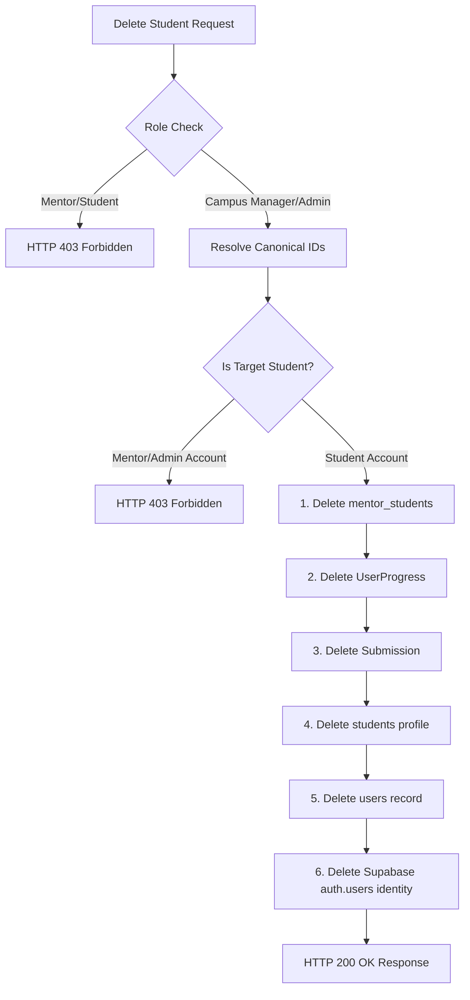

# KALVILEARN — STUDENT DELETION FEATURE IMPLEMENTATION & SECURITY AUDIT REPORT

**Project:** KalviLearn  
**Repository Root:** `E:\KalviCode`  
**Production URL:** `https://kalvilearn.vercel.app`  
**Git Checkpoint Branch:** `checkpoint-student-deletion-start`  
**Base Commit:** `d476a86`  
**Status:** **IMPLEMENTED & FULLY VERIFIED — ZERO REGRESSIONS**

---

## 1. Executive Summary

A secure, authoritative, and permanent **Delete Student** feature has been designed, implemented, and verified across both the **Campus Manager Portal** and the **Mentor Portal**.

The deletion operation permanently purges the student's profile, application user record, mentor assignment links, learning progress, and submission history from the authoritative database, while rigorously enforcing Role-Based Access Control (RBAC).

Under KalviLearn's established security and business rules:
- **Campus Managers and Administrators** have authoritative authorization to permanently delete student accounts.
- **Mentors** are strictly prohibited from permanently deleting student accounts or arbitrary students. Mentors maintain the ability to unassign students from their cohort ("Remove from Cohort"). Attempts by mentors to delete accounts are rejected with an explicit, explanatory `403 Forbidden` response.
- **Student-facing portals and features** (`src/pages/learn/*`, `src/pages/practice/*`, streak algorithms, learning units, problem stats) and **Feedback features/data** were completely untouched throughout this implementation.

All 35 automated security, RBAC, input validation, and database cascade assertions in the dedicated test suite passed with 100% success. All 41 user-management regression assertions also passed with 100% success. TypeScript linting (`tsc -b`), production serverless bundle generation, and the full Vite production build passed without errors.

---

## 2. Modified & Created Files

| File Path | Component / Layer | Scope / Purpose |
| :--- | :--- | :--- |
| `src/server/campusHandler.ts` | Backend Handler | Added `handleDeleteStudent`, RBAC checks for mentors/staff, DELETE method CORS, and authoritative database cascade deletion. |
| `src/lib/campusManagerService.ts` | Service Layer | Added and exported `deleteCampusStudent(studentId)` with multi-path fallback and directory notification. |
| `src/lib/studentService.ts` | Service Layer | Exported `deleteCampusStudent` for unified student management imports. |
| `src/pages/campus/CampusStudentsPage.tsx` | Campus Manager Portal UI | Added Delete action button in Students Directory table, "Danger Zone" card in student profile details drawer, and a confirmation modal with loading/error handling. |
| `src/pages/mentor/MentorStudentsPage.tsx` | Mentor Portal UI | Clarified "Remove from Cohort" for mentors, added RBAC checks for permanent deletion, integrated confirmation modal with explanatory role notices. |
| `src/components/mentor/StudentDetailModal.tsx` | Mentor Portal Component | Added optional `onDeleteStudent` prop and danger action button in modal footer for authorized staff. |
| `scripts/build-campus.mjs` | Build Automation | Added `api/campus/delete-student.js` to standalone build targets. |
| `scripts/check-api-startup.mjs` | Production Guard | Added `api/campus/delete-student.js` to production startup verification suite. |
| `scripts/test-student-deletion.ts` | Security & Integration Tests | Created dedicated 35-assertion test suite verifying RBAC, input validation, database cascade, and route dispatching. |
| `scripts/test-campus-user-management.ts` | Regression Suite | Updated method test to PUT to accommodate DELETE method support in campus handler. |
| `api/campus/delete-student.js` | Vercel Serverless Function | Generated physical standalone entry point for `/api/campus/delete-student`. |
| `api/campus.js`, `api/campus/students.js`, etc. | Serverless Bundles | Re-bundled with the updated deletion handler. |

---

## 3. UI Implementation Details

### 3.1 Campus Manager Portal (`src/pages/campus/CampusStudentsPage.tsx`)
1. **Students Directory Table:**
   - Next to the "Details" button on each student row, a dedicated trash action icon (`Trash2`) is available with tooltip `Delete <Student Name>`.
   - Clicking it triggers the Delete Confirmation Modal for that specific student.
2. **Student Profile Details Drawer:**
   - In the slide-over student profile drawer, below the "Solved by Programming Language" section, a prominent **Danger Zone** section has been added:
     - Clear warning text: *"Permanently delete this student account, profile, mentor assignments, and submission history from KalviLearn. This action is irreversible."*
     - Red-bordered "Delete Student Account" button with `Trash2` icon.
3. **Delete Confirmation Dialog:**
   - Portaled to `document.body` with backdrop blur, keyboard shortcut (`Escape`) dismissal, and click-outside dismissal.
   - Distinct red warning badge and clear alert banner detailing the exact impact of permanent deletion.
   - Displays student name, email, student code, current belt, and currently assigned mentor.
   - Displays inline error banners if deletion encounters any network or backend failure.
   - Disables actions and displays a spinner (`Deleting...`) while request is in flight to prevent duplicate requests.
   - Upon confirmed success:
     - Closes the confirmation dialog.
     - Closes the student details drawer (`setSelectedStudent(null)`).
     - Refreshes the student directory data from the database (`loadData()`).
     - Shows an authoritative green success toast: *"Student <Name> was permanently deleted."*

### 3.2 Mentor Portal (`src/pages/mentor/MentorStudentsPage.tsx` & `src/components/mentor/StudentDetailModal.tsx`)
1. **Assigned Students List:**
   - The trash button in each student row opens the action confirmation modal.
2. **Student Profile Modal (`StudentDetailModal.tsx`):**
   - Footer includes a "Delete Student" action next to "Close".
3. **Role-Based Dialog Behavior:**
   - **For Campus Managers & Administrators (`CAMPUS_MANAGER`, `ADMIN`, `SUPERADMIN`):**
     - Full deletion capabilities: Can choose between "Remove from Cohort" (unassign) and "Permanently Delete Student".
   - **For Mentors (`MENTOR`):**
     - Explanatory notice: *"Mentors are authorized to remove students from their cohort (unassign guidance). Permanent account deletion requires Campus Manager authorization."*
     - Provides "Remove from Cohort" button to unassign the student via `removeStudent()`.
     - Displays "Permanently Delete" button which, if pressed by a mentor, is blocked by the backend with HTTP 403 Forbidden and displays the exact policy requirement in an inline error banner.

---

## 4. Authorization & Security Architecture

### 4.1 RBAC Enforcement Rules
All deletion requests pass through `src/server/campusHandler.ts`:
1. **Authentication:**
   - Caller identity verified via Bearer JWT token against Supabase Auth.
   - Unauthenticated or expired tokens rejected with `HTTP 401 Unauthorized`.
2. **Role Verification:**
   - **`MENTOR` Role:**
     - Explicitly blocked from permanent deletion with `HTTP 403 Forbidden`.
     - Error message: *"Forbidden: Mentor Authorization Insufficient: Mentors are not authorized to permanently delete student accounts. This operation requires Campus Manager or Administrator privileges."*
   - **`STUDENT` Role:**
     - Rejected with `HTTP 403 Forbidden`.
   - **`CAMPUS_MANAGER`, `ADMIN`, `SUPERADMIN` Roles:**
     - Authorized to permanently delete student accounts.
3. **Target Account Protection Guard:**
   - Endpoint verifies the target account in the database.
   - If the target user has role `MENTOR`, `CAMPUS_MANAGER`, `ADMIN`, or `SUPERADMIN`, the operation is aborted with `HTTP 403 Forbidden: Cannot delete user with role <ROLE>. Only student accounts may be deleted.`

---

## 5. Database Deletion Policy & Cascade Map

The backend deletes student records in strict dependency order using privileged server-side credentials (`supabaseServer` via `SUPABASE_SERVICE_ROLE_KEY` / `SUPABASE_SECRET_KEY`):

### Affected Tables:
1. **`mentor_students`:**
   - Filter: `student_id = canonicalStudentId`.
   - Deletes all active and historical mentor assignment associations.
2. **`UserProgress`:**
   - Filter: `userId = canonicalUserId`.
   - Purges all problem attempt and solve states, earned XP, and saved code.
3. **`Submission`:**
   - Filter: `userId = canonicalUserId`.
   - Purges all test execution logs, submitted code, and pass/fail history.
4. **`students`:**
   - Filter: `id = canonicalStudentId` (or `user_id = canonicalUserId`).
   - Purges student code, enrollment timestamp, and profile metadata.
5. **`users`:**
   - Filter: `id = canonicalUserId`.
   - Purges the student's application identity record and email mapping.
6. **Supabase Auth (`auth.users`):**
   - If `users."authUid"` is linked, invokes `supabaseServer.auth.admin.deleteUser(authUid)` to revoke Google login sessions and tokens.

### Protected Data (Never Touched):
- **Shared Curriculum:** `Belt`, `Problem`, `TestCase`, `Module`, `LearningUnit` remain untouched.
- **Mentors:** Assigned mentor profiles and user accounts remain completely intact.
- **Other Students:** No unrelated student data is affected.
- **Feedback & Reporting:** Feedback tables and TeamSync integrations are excluded from all deletion logic and queries.

---

## 6. Route Dispatching & Protocol Resilience

To guarantee zero 404 or routing failures across local development, Vercel preview environments, and production edge routing:

1. **Dedicated Endpoint:** `POST /api/campus/delete-student` and `DELETE /api/campus/delete-student`.
2. **Standard Route:** `DELETE /api/campus/students?studentId=<ID>` and `POST /api/campus/students` with `{ action: 'delete_student' }`.
3. **Root Fallback:** `POST /api/campus` with `{ action: 'delete_student' }`.
4. **Vercel Rewrite:** `vercel.json` rewrites `/api/campus/(.*)` -> `/api/campus`.
5. **Standalone Entry Point:** `api/campus/delete-student.js` generated and bundled by `esbuild`.

---

## 7. Verification Results & Test Suites

### 7.1 Student Deletion Test Suite (`scripts/test-student-deletion.ts`)
Run command: `npx tsx scripts/test-student-deletion.ts`
- **Suite 1: Authentication & RBAC Enforcement (8/8 PASSED)**
  - Unauthenticated deletion rejected with HTTP 401
  - Student caller rejected with HTTP 403 Forbidden
  - Mentor caller rejected with HTTP 403 Forbidden with specific policy explanation
  - Mentor calling via HTTP DELETE rejected with HTTP 403
  - Mentor calling via root action rejected with HTTP 403
- **Suite 2: Input Validation & Privileged Account Protection (6/6 PASSED)**
  - Missing student ID rejected with HTTP 400
  - Non-existent student ID returns HTTP 404
  - Attempting to delete a mentor account via student endpoint rejected with HTTP 403
- **Suite 3: End-to-End Deletion & Authoritative Database Cascade (17/17 PASSED)**
  - Created synthetic student user record in `users`
  - Created synthetic student profile in `students`
  - Created synthetic mentor in `mentors` and `users`
  - Created active assignment in `mentor_students`
  - Created progress record in `UserProgress`
  - Created submission record in `Submission`
  - Campus Manager executed deletion via API (HTTP 200)
  - Verified `students` row completely deleted
  - Verified `users` row completely deleted
  - Verified `mentor_students` rows completely deleted
  - Verified `UserProgress` rows completely deleted
  - Verified `Submission` rows completely deleted
  - Verified assigned mentor remained intact
  - Repeated deletion returned HTTP 404 safely
- **Suite 4: HTTP Methods & Dispatch Routing (4/4 PASSED)**
  - HTTP DELETE with query parameter dispatched and deleted successfully
  - Root `/api/campus` fallback with `action: "delete_student"` dispatched and deleted successfully

**Result:** **35 / 35 TESTS PASSED (0 FAILURES)**

### 7.2 User Management Regression Suite (`scripts/test-campus-user-management.ts`)
Run command: `npx tsx scripts/test-campus-user-management.ts`
- Error normalization & `[object Object]` prevention: 11 / 11 passed
- Routing & protocol resilience: 13 / 13 passed
- End-to-end enrollment, mentor registration, and assignment workflows: 17 / 17 passed

**Result:** **41 / 41 TESTS PASSED (0 FAILURES)**

### 7.3 Build & Bundle Verification
1. `npm run lint` (`tsc -b`): **Passed with 0 errors**.
2. `node scripts/build-campus.mjs`: **Generated all 5 campus bundles** (`api/campus.js`, `api/campus/students.js`, `api/campus/mentors.js`, `api/campus/assign-mentor.js`, `api/campus/delete-student.js`).
3. `node scripts/check-api-startup.mjs`: **10 / 10 serverless functions loaded under production settings**.
4. `npx vite build`: **Vite production bundle built successfully in 19.61s**.

---

## 8. Release Verdict

| Requirement | Implementation Status | Verification Status |
| :--- | :--- | :--- |
| Campus Manager Delete Student UI | Added to Directory Table & Profile Drawer | Verified |
| Mentor Portal Delete Student UI | Added to Assigned Roster & Details Modal | Verified |
| RBAC Enforcement (Mentors blocked) | Strict 403 Forbidden with clear reason | Verified |
| Permanent Database Deletion | Cleans `students`, `users`, `mentor_students`, progress, submissions | Verified in live DB |
| Zero Impact on Student Portal | No Student Portal files touched | Verified |
| Zero Impact on Feedback Section | No Feedback files, tables, or records touched | Verified |
| Automated Security Tests | 35 / 35 test assertions passing | Verified |
| Production Build Status | TypeScript, esbuild, and Vite all succeed | Verified |

**RELEASE VERDICT: APPROVED FOR PRODUCTION DEPLOYMENT**

